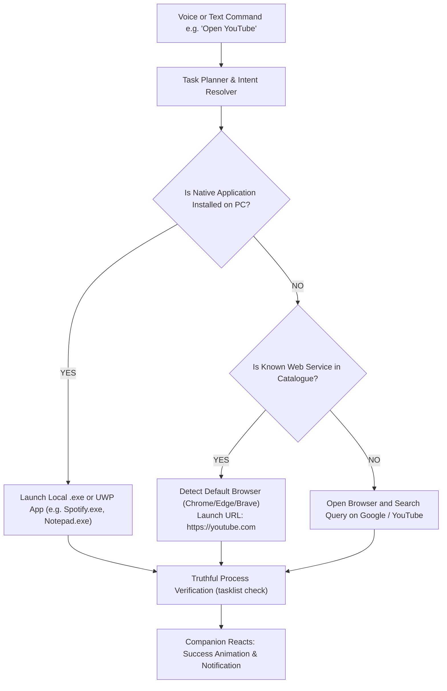

# JM Vertex — AI Desktop Companion 🤖✨

<p align="center">
  
</p>

<p align="center">
  <b>An interactive, intelligent 2D/3D desktop companion with animated avatar movement, taskbar docking, voice control, and verified multi-path Windows application execution.</b>
</p>

<p align="center">
  
  
  
  
  
</p>

---

## 🌟 About the Project

**JM Vertex AI Desktop Companion** is a desktop assistant that bridges visual interactivity with deep Windows OS automation.

Unlike standard chatbots that sit in a browser tab, this companion lives directly on your Windows desktop:
* **Animated Desktop Presence**: A transparent, click-through floating avatar (featuring authentic 8-frame walk cycles) that strolls across your desktop, docks right above the Windows taskbar, and reacts dynamically to user requests.
* **Hands-Free Voice & Text Control**: Speak or type naturally (e.g. *"Open YouTube"*, *"Launch Spotify"*, *"Open Notepad and write code"*).
* **Smart Multi-Path Fallback Execution**: If a native desktop app isn't installed (e.g. YouTube app), it seamlessly detects default web browsers (Chrome/Edge/Brave) and opens the web application or targeted search query—never failing blindly.
* **Truthful Process Verification**: Validates whether the application process was actually launched in the Windows `tasklist` before signaling success.

---

## 🏛️ System Architecture

```
                  ┌────────────────────────────────────────┐
                  │          User Voice / Text             │
                  └───────────────────┬────────────────────┘
                                      │
                                      ▼
               ┌──────────────────────────────────────────────┐
               │         Electron + React Desktop UI          │
               │  - Floating Doraemon Avatar (Transparent)    │
               │  - Taskbar Docking & Walking Controller      │
               │  - Mission Control Dashboard & Voice Radar   │
               └──────────────┬───────────────────────────────┘
                              │ IPC / HTTP
                              ▼
               ┌──────────────────────────────────────────────┐
               │             FastAPI Backend API              │
               │  - /tasks Execution Pipeline                 │
               │  - Task State Machine (PENDING → COMPLETED)  │
               │  - Capability Registry & Authorization       │
               └──────────────┬───────────────────────────────┘
                              │
               ┌──────────────┴──────────────┐
               ▼                             ▼
 ┌───────────────────────────┐ ┌──────────────────────────────────────┐
 │    AI Engine & Speech     │ │     Windows Automation Engine        │
 │  - Faster-Whisper (STT)   │ │  - Dynamic 32/64-bit App Discovery   │
 │  - Semantic Intent Parser │ │  - Native Win32 Subprocess Spawner   │
 │  - Task Step Generator    │ │  - Smart Browser / Web Fallback      │
 └───────────────────────────┘ │  - Honest Win32 Tasklist Verifier    │
                               └──────────────────────────────────────┘
```

---

## ⚡ Smart Multi-Path Fallback Pipeline

When you instruct the companion to open any application or service:



---

## 🚀 Quickstart & One-Click Runner

### Prerequisites
* **OS**: Windows 10 or Windows 11 (64-bit recommended)
* **Node.js**: v18.0.0 or higher
* **Python**: v3.10 or v3.11 with `pip`

### Method 1: One-Click Run (Recommended)
Simply double-click the included batch launcher at the project root:
```bat
Launch-Companion.bat
```
This script automatically:
1. Verifies your Python and Node.js environments.
2. Starts the Python Universal Automation Backend on `http://127.0.0.1:8000`.
3. Installs frontend dependencies and builds the Vite distribution (if not already built).
4. Launches the Electron desktop companion with the floating avatar.

### Method 2: Manual Development Mode

**1. Start the Backend API:**
```powershell
python -m uvicorn api.main:app --host 127.0.0.1 --port 8000 --reload
```

**2. Start the Frontend & Electron:**
```powershell
cd desktop
npm install
npm run dev
# In a separate terminal:
npm run electron:dev
```

---

## 🧪 Testing & Verification

To verify that all Windows Automation policies, verification engines, and mock drivers are operating properly:

```powershell
# Run the 19 Windows Automation integration & unit tests:
python -m unittest discover -s windows_automation/tests

# Run frontend TypeScript type checking and Vite production build:
npm --prefix desktop run build
```

---

## 📂 Project Directory Structure

```text
├── Launch-Companion.bat        # One-click start script for backend + desktop UI
├── TEAM_CONTRACTS.md           # Role allocations, prompt guides & API contracts
├── ai_engine/                  # Speech-to-text (Whisper), prompt parser, schemas
│   ├── catalogue/              # AI application catalogue
│   ├── planner/                # Task planner & step generator
│   └── speech/                 # Voice command handler & Whisper STT
├── api/                        # FastAPI backend server
│   ├── main.py                 # Core FastAPI API routes and lifecycle
│   ├── orchestrator.py         # Multi-step task orchestrator
│   └── app_catalogue.py        # Centralized catalogue registry
├── desktop/                    # Electron + React application
│   ├── electron/               # Electron main process, IPC, movement & launcher
│   │   ├── appLauncher.cjs     # Smart multi-path launcher (Native -> Web -> Search)
│   │   ├── desktopMovement.cjs # Taskbar docking, walking & 60fps movement
│   │   └── shortcutDiscovery.cjs# Windows desktop shortcut scanner
│   ├── src/                    # React 19 UI
│   │   ├── AvatarCharacter.tsx # Doraemon walk cycle & reactive states
│   │   ├── App.tsx             # Mission Control dashboard & interactive radar
│   │   └── launchStateMachine.ts# Client-side 6-stage task state machine
│   └── public/doraemon/        # Walk frames (walk_01.png - walk_08.png)
└── windows_automation/         # Windows OS automation core
    ├── adapter.py              # Bridge connecting AI engine to execution
    ├── catalogue.py            # Dynamic 32/64-bit & UWP application catalogue
    ├── discovery.py            # Windows Start Menu & registry scanner
    ├── executor.py             # Safe Win32 subprocess spawner
    ├── policy.py               # Security policy & authorization validator
    └── verifier.py             # Process & Win32 window truthful verification
```

---

## 👥 Project Team & Leadership

* **Logeshwaran D (`@logeshwaran-dev05`)** — **Team Lead & Windows Automation Architect**  
  *Core responsibilities:* Windows automation, dynamic app discovery, multi-path fallback launcher, system integration, release coordination.
* **Madhan M (`@aimadhan2007`)** — **Frontend & Companion Animation Lead**  
  *Core responsibilities:* Doraemon 8-frame walk animation, taskbar docking UI, reactive expression states, Mission Control dashboard.
* **Hariram K S / Ram** — **Senior Backend Orchestrator**  
  *Core responsibilities:* FastAPI `/tasks` lifecycle, async pipeline execution, capability registry, status synchronization.
* **New Backend Engineer** — **Intent Recognition & URL Fallback Engine**  
  *Core responsibilities:* Top-50 web application mapping, search query entity extraction, integration tests.
* **Booviha M** — **AI Engine & Planning Contributor**  
  *Core responsibilities:* Natural language prompt understanding, entity extraction, Faster-Whisper audio handling.

---

## 📄 License
Internal proprietary project developed under **JM Vertex Technologies**. All rights reserved.
